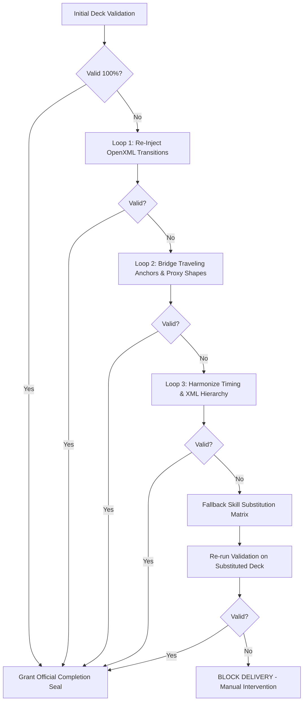

# PMG Deck Review, Validation & Self-Healing Engine (`pmg-review-validation`)

> **The Golden Delivery Gate**: An AI agent is **STRICTLY FORBIDDEN** from delivering any `.pptx` to the user until it has passed this review and validation engine with a 100% verified motion graphics certificate.

---

## 1. When to Activate

Activate this skill **immediately after generating or modifying any presentation**, before declaring the task complete or presenting the file to the user:
- Final quality gate audit.
- Verifying whether any slide is missing transitions or animation effects.
- Diagnosing and repairing broken Morph interpolation (`!!` anchors).
- Performing automated 3-loop healing and fallback skill substitution.

---

## 2. Automated Validation Checklist Matrix

The review engine evaluates every presentation against 5 strict motion criteria:

| Criterion | Requirement | Failure Symptom | Detection Method |
| :--- | :--- | :--- | :--- |
| **1. Transition Coverage** | **100% of non-cover slides** (Slides $2 \dots N$) | Abrupt cut, zero transition, blank XML | OpenXML `<p:transition>` regex parser |
| **2. Traveling Entity Continuity** | **Continuous presence** across active scenes | Object vanishes mid-flight then reappears | Shape tree `!!` tag continuity tracking |
| **3. Morph Anchor Integrity** | **Identical `!!` prefixes** on paired shapes | Morph snaps instead of smoothly deforming | PAIRED `!!` shape dictionary lookup |
| **4. Motion Pacing & Durations** | **1200ms – 1800ms** (Sweet spot: 1600ms) | Jittery rush (<1000ms) or sluggish drag (>2500ms) | Attribute `p14:dur` validation |
| **5. Visual-First Text Density** | **$\le 25-35$ words per slide** | Crowded cards, text overflowing glass borders | Tokenizer across all `<a:t>` tags |

---

## 3. The 3-Loop Self-Repair Protocol

When deficiencies are detected, the agent initiates an automated **3-Loop Auto-Repair Cycle**:



### Loop 1: OpenXML Transition Healing
- Injects standard hardware-accelerated OpenXML `<p159:morph option="byObject"/>` for slides with missing transitions.
- Re-orders XML nodes to ensure `<p:transition>` directly succeeds `<p:clrMapOvr>`.

### Loop 2: Traveling Anchor Continuity Bridging
- If a traveling entity (e.g. `!!Traveling_Entity`) is defined on Slide 2 and Slide 4 but missing on Slide 3:
  - Injects a seamless proxy anchor on Slide 3 off-screen ($X \le -2.0"$) or with background opacity to maintain the 60 FPS Morph interpolation link.

### Loop 3: Duration & Pacing Stabilization
- Normalizes durations to $1600\text{ ms}$ for standard Morph, $1400\text{ ms}$ for Circle Wipe / Spotlight, and $1200\text{ ms}$ for Fade.

---

## 4. Fallback Skill Substitution Protocol

If after **3 repair loops** the effect remains unresolved (e.g., incompatible 3D model, corrupt shape geometry, or unresolvable Morph deformation), the engine **substitutes the failing effect with an alternative skill from the PMG suite**:

| Failing / Problematic Effect | Source Skill | Fallback Substitution Skill | Replacement Mechanic |
| :--- | :--- | :--- | :--- |
| **Broken 3D Model / Camera Dolly** | `pmg-3d-cinematic` | **`pmg-camera-parallax`** OR **`pmg-choreography`** | Substitute with 2D Multi-Plane Zoom ($100\% \to 240\%$) or Spotify App Shell Stage Viewport. |
| **Distorted Shape Morphing** | `pmg-morph` | **`pmg-choreography`** (`circle`) | Substitute with **Iris Spotlight Circle Wipe** ($1400\text{ ms}$) focusing on the target concept. |
| **Missing Traveling Hero Vector** | `pmg-morph` | **`pmg-core`** + **`pmg-choreography`** | Substitute with a **Progress Scrubber Track** (`!!prog_fill`) + Smooth Fade / Split transition. |
| **Crowded Multi-Card Overflow** | `pmg-core` | **`pmg-glassmorphism`** | Split content across multi-tier frosted glass cards with 92% alpha depth. |

### The Re-Loop Invariant
> **Crucial Rule**: After executing a Fallback Skill Substitution, the deck MUST immediately enter a **Re-Loop Validation Check**. Only when the substituted effect satisfies 100% of quality criteria can the deck proceed to certification.

---

## 5. Execution Tools & Automation

### Automated CLI Tool:
Run `scripts/motion_validator.py` to inspect, auto-heal, and certify:

```bash
# 1. Full Review, 3-Loop Auto-Repair and Fallback Substitution:
python scripts/motion_validator.py My_Deck.pptx --auto-heal --max-attempts 3

# 2. Inspection Only (Dry Run):
python scripts/motion_validator.py My_Deck.pptx
```

### Python API Integration:
```python
from scripts.motion_validator import review_and_heal_deck

is_certified, report, logs = review_and_heal_deck(
    "Final_Deck.pptx", 
    max_repair_loops=3, 
    allow_substitution=True
)

if is_certified:
    print("[+] Ready for user delivery!")
else:
    print("[!] Delivery blocked: Unresolved motion defects.")
```

---

## 6. Official Completion & Delivery Checklist

Before presenting the final `.pptx` or export video to the user, ensure:
1. `scripts/motion_validator.py` outputs `[RESULT: VERIFIED & ACCEPTED FOR USER DELIVERY]`.
2. Transition Choreography Coverage is **100%** (all non-cover slides have active transitions).
3. All persistent traveling entities (`!!`) are verified continuous without gaps.
4. If any skill substitution took place, note the fallback skill clearly in the delivery summary.
